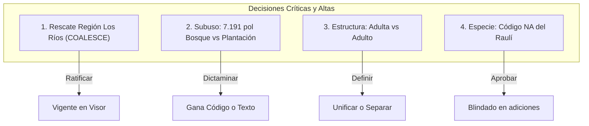

# Informe Técnico Exhaustivo de Homologaciones y Matriz de Aprobaciones

**Proyecto:** Visor Nacional del Catastro de Usos de la Tierra y Recursos Vegetacionales de Chile  
**Destinatario:** Equipo de Monitoreo / Unidad de Información y Análisis (UIA) - Gerencia de Fiscalización Forestal y Evaluación Ambiental, CONAF  
**Autor:** Equipo de Desarrollo de Datos y Visor Cartográfico  
**Fecha de corte:** Octubre 2026  
**Universo de datos evaluado:** 1.827.933 polígonos | 75.661.200,40 hectáreas catastradas a nivel nacional  
**Ubicación del repositorio:** Raíz del proyecto (`HOMOLOGACIONES_Y_APROBACIONES_MONITOREO.md`)

---

## 1. Resumen Ejecutivo y Propósito

El presente documento detalla exhaustivamente **todas las homologaciones, correcciones, fusiones, rescates y estandarizaciones de datos** aplicadas durante la construcción del Visor Cartográfico del Catastro Nacional de Recursos Vegetacionales de CONAF, así como los **puntos críticos que requieren revisión y aprobación formal por parte del Equipo de Monitoreo**.

### 1.1 El problema de origen en los datos
El Catastro Nacional no es una base de datos estática levantada en un solo momento; es el resultado de décadas de actualizaciones regionales descentralizadas (cubriendo periodos entre 2014 y 2024 según la región), levantadas por distintos equipos agronómicos y forestales, con diversas herramientas y con dos sistemas paralelos de codificación (Catastro de Bosque Nativo - CBN vs. SIMEF).

Al integrar los 1,82 millones de polígonos a nivel de país, se detectaron:
1. **Unidades territoriales partidas en dos:** Unidades del SNASPE y subtipos forestales que aparecían duplicados por diferencias en el uso de espacios alrededor de guiones tipográficos o mayúsculas intermedias (por ejemplo, el Parque Nacional Bernardo O'Higgins figuraba bajo dos grafías sumando 3,81 millones de hectáreas divididas).
2. **Pérdida de regiones completas:** La Región de Los Ríos (79.727 polígonos y 1.835.307,15 ha) no aparecía asociada a ninguna comuna en el atributo estándar, provocando que cualquier consulta regional devolviera las cifras de todo el país.
3. **Pérdida silenciosa de especies clave por lectura computacional:** El código oficial de especie del Raulí (`NA`) era interpretado como nulo (`NaN` / *Not a Number*) por librerías analíticas como Pandas o R, borrando 3.654 polígonos y casi 90.000 ha de un recurso forestal de primer orden.
4. **Mojibakes y caracteres corruptos:** Códigos y nombres científicos con corrupción de codificación de caracteres (`UTF-8` vs `ISO-8859-1`/`Windows-1252`).
5. **Divergencias entre Códigos Oficiales y Texto:** Polígonos donde el texto descriptivo indicaba «Bosque» pero el código de uso indicaba «Plantación».

### 1.2 Objetivo de este documento para el Equipo de Monitoreo
Este informe no solo explica qué reglas técnicas se aplicaron para garantizar que el visor funcione sin emitir cifras falsas, sino que somete a consideración del **Equipo de Monitoreo** una **Matriz de Aprobaciones Formales** con casos donde:
- Se implementó una solución técnica fundada que debe ser ratificada institucionalmente.
- Existen casos de toponimia o botánica que fueron deliberadamente **retenidos sin aplicar** (en estado `revisar`) para que sea el equipo especialista quien determine la grafía canónica oficial.

---

## 2. Principios y Reglas Metodológicas del ETL

Para garantizar la integridad matemática y científica del visor, el proceso de extracción, transformación y carga (ETL en `ETL/build_bin.py` y `ETL/homologacion/`) se rige bajo **cinco reglas de oro**:

### Regla 1: Catálogo Cerrado (`H.exigir`)
Las tablas de homologación funcionan como un **catálogo cerrado estricto**. Si el origen de datos contiene un solo valor, código, comuna o especie que no figure explícitamente en las tablas de homologación, el script de construcción (`build_bin.py`) **se detiene con un error fatal y muestra el valor en pantalla**.  
*Razón técnica:* Una tabla de homologación que ignora silenciosamente los valores desconocidos no homologa; oculta la corrupción del dato y permite que valores espurios lleguen a la ciudadanía.

### Regla 2: La acción `revisar` NO se aplica automáticamente
El libro de homologación original de la Unidad (`INSUMO/homologacion_catastro_1.xlsx`) marcaba con la etiqueta `revisar` aquellos nombres donde la grafía de la capa difería de la toponimia oficial por algo más que un acento (ej. *Calera* vs *La Calera*, *Coihaique* vs *Coyhaique*, *Mariquina* vs *San José de la Mariquina*).  
*Razón técnica:* El equipo técnico de desarrollo de software **no puede ni debe arrogarse la facultad de zanjar la toponimia oficial de Chile**. Por tanto, la acción `revisar` no modifica el dato en el visor: el valor se publica tal como venía en la capa original mientras el Equipo de Monitoreo no lo ratifique formalmente.

### Regla 3: Sensibilidad estricta a Mayúsculas y Minúsculas (*Case-Sensitivity*) en Especies
En bases de datos comunes suele aplicarse la función `UPPER()` o `LOWER()` para estandarizar textos. En el Catastro Forestal chileno **esto está terminantemente prohibido**:
- De 207 grupos de códigos de especie que solo difieren en el uso de mayúsculas/minúsculas, **206 representan especies biológicamente distintas**.
  - Ejemplo: `AB` = *Abies sp.* (Abeto, exótica), `Ab` = *Adesmia boronioides* (Paramela, nativa), `ab` = *Calceolaria biflora* (Hierba nativa).
  - Un simple `UPPER()` sobre la columna colapsaría especies nativas con plantaciones exóticas e hierbas en un solo código erróneo.
  - Además, existen 7 nombres comunes que solo difieren en mayúsculas: `Llareta` (*Azorella compacta*) vs `llareta` (*Azorella madreporica*); `totora` (*Typha angustifolia*) vs `Totora` (*Schoenoplectus pungens*).

### Regla 4: El Nombre Común NO es Clave de Unión
En el Catastro existen **53 nombres comunes compartidos por dos o más especies científicas distintas**:
- «Álamo» corresponde a tres especies distintas del género *Populus* (*P. nigra*, *P. alba*, *Populus sp.*).
- «Aromo» corresponde a tres especies (*Acacia dealbata*, *Acacia melanoxylon*, *Acacia retinodes*).
- «Totora» involucra dos familias taxonómicas distintas.  
Por lo tanto, la unión, filtrado y cálculo se realiza **únicamente por el código científico de especie (`ID_ESP1`)**, garantizando que nunca se confundan especies con idéntico nombre vernáculo.

### Regla 5: La homologación de Especies toca Etiquetas, NUNCA Códigos
La hoja 12 del libro de homologación proponía dos cambios en los códigos de especie. Ambos fueron rechazados en la compilación:
1. `ÃÂ` → `(recuperar del origen)`: Esto no es un código, es una anotación humana. Aplicarlo crearía una especie con ese texto literal.
2. `wÃ` → `wñ`: Una fusión de dos códigos donde 1,83 millones de polígonos serían reenlazados. Debe ser decisión formal de Monitoreo.
El ETL homologa las **etiquetas** (nombre científico y nombre común), pero **preserva la clave primaria del código de origen** para evitar descalces relacionales.

---

## 3. Detalle Exhaustivo de Homologaciones por Dimensión

A continuación se desglosan las 16 familias de datos del Catastro, explicando qué cambios se aplicaron, cuántas hectáreas y polígonos impactan, y qué justificación técnica los respalda.

---

### 3.1 Dimensión 01: Uso del Suelo (`01_uso.csv`)
- **Total de clases oficiales:** 9 clases (`01` Praderas y Matorrales, `02` Bosques, `03` Terrenos Agrícolas, `04` Humedales, `05` Áreas Desprovistas de Vegetación, `06` Nieves y Glaciares, `07` Cuerpos de Agua, `08` Áreas Urbanas e Industriales, `09` Otros Terrenos).
- **Acción realizada:** `sin_cambio` en las 9 clases.
- **Detalle técnico:** Se respeta el orden numérico estricto de códigos (`01` a `09`) y no el orden por superficie. Esto es vital porque el índice numérico se empaqueta en formato binario de 1 byte (`Uint8Array`) y se refleja en los parámetros de la URL compartida (`?uso=02`). Reordenar por frecuencia rompería todos los hipervínculos compartidos por los usuarios.
- **Rótulo adoptado:** Se usa la denominación del Catastro (*Bosques*), no la nomenclatura IPCC de SIMEF (*Tierras Forestales*), respetando la identidad del dato ante el usuario.

---

### 3.2 Dimensión 02: Subuso del Suelo (`02_subuso.csv`)
- **Total de clases:** 37 clases.
- **Acción realizada:** Derivación directa desde el código oficial de 6 dígitos (`usos_comb` en `tab.xls_guia_codigos_v3_usos_comb`).
- **Divergencias de texto resueltas (51.054 filas):**
  El texto de la capa original traía variaciones de escritura que fueron mapeadas a la etiqueta oficial única:
  - `matorral pradera` vs `matorral-pradera` (8.563 filas).
  - `terrenos de uso agrícola` vs `terreno de uso agrícola` (3.909 filas).
  - `campos de hielos` vs `campos de hielo` (1.248 filas).
  - `praderas perennes` vs `pradera perenne` (52.093 filas en estructura/subuso).
- **Caso Abierto de Fondo (Requiere Aprobación):**
  Existen **7.191 polígonos (24.591,00 ha)** donde el atributo de texto `SUBUSO` dice «Bosque», pero el código numérico oficial de 6 dígitos dice «Plantación».  
  *Decisión adoptada provisionalmente en el visor:* Se priorizó el código oficial frente al texto, lo que coincide con los balances de superficie oficial de plantaciones forestales.

---

### 3.3 Dimensión 03: Estructura del Bosque (`03_estructura.csv`)
- **Total de clases:** 17 clases oficiales.
- **Acción realizada:** Derivación directa desde el código de 6 dígitos (`usos_comb`).
- **Hallazgo crítico detectado:** Intentar decodificar la estructura de CBN usando los descriptores de SIMEF (`ID_EST`) produce **897.281 filas corruptas**: decodifica «Renoval» (330.654 filas) como «Nativo con exóticas asilvestradas». Se demostró que CBN y SIMEF usan sistemas de codificación incompatibles en este campo.
- **Caso Abierto en `14_REVISAR.csv`:**
  - Presencia simultánea de `Adulta` y `Adulto` en las etiquetas de estructura. Requiere que Monitoreo confirme si se trata de un desajuste gramatical (género) o de dos clases técnicas independientes.

---

### 3.4 Dimensión 04 y 05: Tipo Forestal y Subtipo Forestal (`04_tipo_forestal.csv`, `05_subtipo_forestal.csv`)

#### Tipo Forestal (13 clases oficiales)
- **Acción realizada:** Derivación por código oficial `ID_TIFO` con descriptores.
- **Corrección única aplicada:** Homologación de `roble - hualo` (con espacios) hacia la forma canónica oficial `roble-hualo`. Afecta a **6.060 filas y 168.401 hectáreas**.

#### Subtipo Forestal (37 clases de origen → 33 clases canónicas)
El código `ID_STIF` de la base original no es confiable (posee solo 10 códigos numéricos para 39 subtipos distintos). Por ello, el subtipo forestal se agrupó mediante un proceso riguroso en dos etapas:
1. **Etapa 1 (Limpieza canónica):** Normalización de saltos de línea, mayúsculas y tildes.
2. **Etapa 2 (Fusión de clases separadas por espacios en guiones):**  
   Se corrigieron 4 pares críticos donde la presencia o ausencia de espacios alrededor del guion partía las clases en dos, dispersando **75.918,86 hectáreas**:
   - `Coihue - Raúl - Tepa` + `Coihue-Rauli-Tepa` → Fusionados en **`Coihue-Raúl-Tepa`** (Total real unificado: **141.296,26 ha**, Tipo Forestal 10).
   - `Roble - Hualo` → Fusionado en **`Roble-Hualo`** (Total real unificado: **184.851,95 ha**, Tipo Forestal 08).
   - `Roble - Raúl - Coihue` → Fusionado en **`Roble-Raúl-Coihue`** (Total real unificado: **281.867,12 ha**, Tipo Forestal 09).
   - `Peumo quillay litre` (en minúsculas y sin separadores) → Fusionado en **`Peumo - Quillay - Litre`** (Total real unificado: **927.096,94 ha**, Tipo Forestal 11).
   - `Olivillo del norte` → Corregido ortográficamente a **`Olivillo del Norte`** (consistencia con *Roble del Norte*).

> **Garantía para URLs Compartidas:** Al fundir estas clases, las grafías minoritarias antiguas que pudieran viajar en enlaces compartidos (`?stifo=roble-hualo`) son traducidas en memoria mediante una tabla de `alias` en el manifest (`manifest.json`), evitando que los filtros queden vacíos.

---

### 3.5 Dimensión 06 y 07: Cobertura y Altura (`06_cobertura.csv`, `07_altura.csv`)

#### Cobertura (6 clases)
- **Vocabulario:** `01` Denso, `02` Semidenso, `03` Abierto, `04` Muy Abierto, `05` Escaso, `00` No Aplica.
- **Acción:** Homologación contra el código oficial `ID_COBER`. La guía oficial no tenía mapeo código a código, pero se demostró matemáticamente que el orden decreciente de la guía coincide exactamente con los códigos 01..05.
- **Centinela de filas sin dato:** 11.261 filas con código nulo/255 no se tocan ni se funden con "No Aplica" porque corresponden a datos faltantes (triplete roto).

#### Altura (12 clases - Dos escalas independientes)
- **Estandarización de formato:** Se homologó el separador decimal de punto a coma en las clases `0 - 0.5` → `0 - 0,5` y `0.5 - 1` → `0,5 - 1`, manteniendo consistencia con toda la tipografía numérica del visor.
- **Estructura de Escalas Técnicas:** El Catastro maneja dos escalas superpuestas que no deben fusionarse jamás:
  1. *Escala Fina:* Clases A a F (2 a >32 m) para Bosques; Clases G a I (0 a 2 m) para Praderas y Matorrales.
  2. *Escala Gruesa:* Clases J y K (`<2` m y `>2` m).
- **Regla estricta de NO FUSIÓN:** `<2` y `>2` son rangos físicamente opuestos. Cualquier normalización de texto automatizada que borre los símbolos `<` y `>` colapsaría ambos valores en «2». El ETL preserva ambos signos de forma obligatoria.

---

### 3.6 Dimensión 08: Áreas Silvestres Protegidas del Estado - SNASPE (`08_snaspe.csv`)
- **Universo original:** 94 unidades en bruto.
- **Universo homologado:** 90 unidades oficiales del SNASPE.
- **Total de cambios aplicados:** 39 transformaciones (8 fusiones, 13 prefijos, 18 correcciones ortográficas).

#### 1. Las 4 Fusiones Críticas de Unidades Duplicadas
Debido a inconsistencias ortográficas en el levantamiento catastral, cuatro de las unidades más grandes de Chile figuraban partidas en dos, subestimando gravemente la superficie si se consultaba una sola de las grafías:
1. **Parque Nacional Bernardo O'Higgins:**
   - Capa original: `Parque Nacional Bernardo Ohiggins` (2.849.820,93 ha) y `Parque Nacional Bernardo OHiggins` (962.126,98 ha).
   - Forma canónica unificada: **`Parque Nacional Bernardo O'Higgins`**.
   - **Superficie total real:** **3.811.947,91 ha** distribuidas en 85.684 polígonos.
2. **Reserva Nacional Ñuble:**
   - Capa original: `Nuble` y `Reserva Nacional Nuble` (sin tilde y sin categoría).
   - Forma canónica unificada: **`Reserva Nacional Ñuble`**.
   - **Superficie total real:** **74.437,97 ha** en 2.634 polígonos.
3. **Parque Nacional Pan de Azúcar:**
   - Capa original: `Pan de Azúcar` (sin categoría) y `Parque Nacional Pan de Azúcar`.
   - Forma canónica unificada: **`Parque Nacional Pan de Azúcar`**.
   - **Superficie total real:** **44.558,70 ha** en 310 polígonos.
4. **Parque Nacional Nahuelbuta:**
   - Capa original: `Nahuelbuta` (sin categoría) y `Parque Nacional Nahuelbuta`.
   - Forma canónica unificada: **`Parque Nacional Nahuelbuta`**.
   - **Superficie total real:** **6.647,12 ha** en 295 polígonos.

#### 2. Normalización de Prefijos y Categoría Legal (13 unidades)
Se antepuso la categoría oficial (`Parque Nacional`, `Reserva Nacional`, `Monumento Natural`) a unidades que venían rotuladas con el topónimo a secas:
- *Altos De Pemehue* → `Reserva Nacional Altos de Pemehue` (y corrección «De»→«de»).
- *Federico Albert* → `Reserva Nacional Federico Albert`.
- *Laguna De Torca* → `Reserva Nacional Laguna de Torca`.
- *Laguna Del Laja* → `Parque Nacional Laguna del Laja`.
- *Llanos de Challe* → `Parque Nacional Llanos de Challe`.
- *Los Bellotos Del Melado* → `Reserva Nacional Los Bellotos del Melado`.
- *Los Ruiles* → `Reserva Nacional Los Ruiles`.
- *Mon. Natural Islotes de Puñihuil* → `Monumento Natural Islotes de Puñihuil` (desabreviación).
- *Nevado Tres Cruces* → `Parque Nacional Nevado Tres Cruces`.
- *Nonguen* → `Parque Nacional Nonguén` (prefijo y tilde).
- *Pinguino de Humboldt* → `Reserva Nacional Pingüino de Humboldt` (prefijo y diéresis).
- *Radal Siete Tazas* → `Parque Nacional Radal Siete Tazas`.
- *Ralco* → `Reserva Nacional Ralco`.

#### 3. Corrección de Categorías Erróneas en la Capa (`CORRECCION_SNASPE`)
En la capa de origen, cuatro unidades venían con categorías que no existen en la legislación del SNASPE:
- `Pan de Azúcar`: Venía sin categoría (69 polígonos) → Corregido a **Parque Nacional**.
- `Pinguino de Humboldt`: Venía como «Reserva Natural» (24 polígonos) → Corregido a **Reserva Nacional**.
- `Monumentro Nacional Lahuen Ñadi`: Traía una errata evidente («Monumentro») y venía clasificado erróneamente en el rótulo como «Nacional» (20 polígonos) → Corregido a **Monumento Natural**.
- `Mon. Natural Islotes de Puñihuil`: Venía rotulado en capa como «Monumento Nacional» (figura del Consejo de Monumentos, no del SNASPE) → Corregido a **Monumento Natural**.
- *Unidad Radal Siete Tazas:* En la capa figuraba con polígonos bajo *Reserva Nacional* y otros bajo *Parque Nacional*. Se adoptó la categoría mayoritaria y vigente: **Parque Nacional**.

#### 4. Supresión de la categoría apócrifa «Protección Especial»
El visor anterior de CONAF mostraba una categoría llamada «Protección Especial» con 1.080.187 hectáreas.  
*Resolución técnica:* Dicha figura **no existe en la Ley de Bosques, en la Ley 19.300 ni en el ordenamiento del SNASPE**. Su inclusión generaba reclamos de legalidad. Dicha clase fue eliminada y los polígonos fueron transparentados bajo su verdadera condición catastral.

---

### 3.7 Dimensión 09, 10 y 11: División Político-Administrativa (`09_comuna.csv`, `10_provincia.csv`, `11_region.csv`, `adiciones.csv`)

#### 1. El Rescate Histórico de la Región de Los Ríos
- **El problema de fondo:** Durante meses, al seleccionar «Región de Los Ríos» en versiones previas del visor, el mapa mostraba **75.661.200 ha y 1.827.933 polígonos** (el país completo). Además, no permitía desplegar ninguna comuna ni provincia de Los Ríos.
- **La causa técnica:** La columna `CODCOM` estaba vacía (`NULL`) en las 79.727 filas de Los Ríos. Al no haber comunas, el conjunto de comunas del selector salía vacío `[]`, lo que en la lógica anterior del código significaba «todas las comunas de Chile».
- **El hallazgo y la solución (`COALESCE`):**  
  Se descubrió que los códigos comunales de Los Ríos existían en la columna alternativa **`Codcomun`** (poblada en las 79.727 filas de Los Ríos y `NULL` en las otras 15 regiones, su complemento exacto).
  Aplicando la sentencia SQL:
  ```sql
  COALESCE(CODCOM, Codcomun)
  ```
  Se recuperaron de inmediato las **12 comunas de Los Ríos**, las **2 provincias** (Valdivia y Ranco) y los **1.835.307,15 hectáreas** de la región.
- **Incorporación en `adiciones.csv`:**  
  Dado que el libro de homologación original de la Unidad no traía las comunas de Los Ríos (porque en su base estaban ausentes), se incorporaron manualmente en el archivo `adiciones.csv`:
  *Corral, Futrono, La Unión, Lago Ranco, Lanco, Los Lagos, Máfil (con tilde), Mariquina, Paillaco, Panguipulli, Río Bueno, Valdivia; Provincias de Ranco y Valdivia; Región de Los Ríos.*

#### 2. Estandarización de Comunas (331 → 343 comunas + 4 polígonos especiales)
- **Total nacional cubierto por Catastro:** 343 comunas. (Nota: Isla de Pascua, Juan Fernández y Territorio Antártico no forman parte de este Catastro continental).
- **Las 4 filas sin comuna de Magallanes:** Corresponden a 127.168,89 ha rotuladas como «Áreas no Reconocidas». Cuentan para el total de la Región de Magallanes gracias a la nueva columna `reg_cod`, resolviendo el hallazgo H4 del informe de la UIA.
- **20 Correcciones Ortográficas de Comunas (Alta Confianza, Aplicadas):**
  Reponen tildes, diéresis o eñes de acuerdo al Instituto Geográfico Militar (IGM):
  *Cochamó, Copiapó, Curacautín, Curaco de Vélez, Futaleufú, Hualaihué, Los Álamos, Los Ángeles, Maullín, Ollagüe, Pitrufquén, Pucón, Puqueldón, Purén, Quellón, Río Negro, Toltén, Traiguén, Vilcún, Máfil.*
- **8 Comunas en Estado `revisar` (NO Aplicadas - Requieren Decisión):**
  El libro de homologación proponía cambiar el nombre que viene en la capa por el nombre oficial del Decreto Ley de división político-administrativa. Se mantuvieron con el nombre de la capa para no intervenir en nomenclatura oficial:
  1. `Calera` → Propuesta: *La Calera*.
  2. `Coihaique` → Propuesta: *Coyhaique*.
  3. `Llaillay` → Propuesta: *Llay-Llay*.
  4. `Padre las Casas` → Propuesta: *Padre Las Casas*.
  5. `Paiguano` → Propuesta: *Paihuano*.
  6. `San Juan de La Costa` → Propuesta: *San Juan de la Costa*.
  7. `Treguaco` → Propuesta: *Trehuaco*.
  8. `Mariquina` → Propuesta: *San José de la Mariquina*.

#### 3. Provincias (53 → 55 provincias)
- 53 provincias originales + Ranco y Valdivia rescatadas = 55 provincias.
- **6 Correcciones ortográficas aplicadas:**
  *Aisén → Aysén, Cautin → Cautín, Coihaique → Coyhaique, Copiapo → Copiapó, Margamarga → Marga Marga, Ultima Esperanza → Última Esperanza.*
- **Incoherencia detectada en el insumo original:**  
  La provincia `Coihaique → Coyhaique` venía marcada como `ortografia` (y se aplicó), pero la comuna `Coihaique` venía marcada como `revisar` (y no se aplicó). Hoy, en el dato publicado, la provincia se llama **Coyhaique** pero la comuna contenida se llama **Coihaique**. Monitoreo debe decidir si unifica ambas con «y» griega.

---

### 3.8 Dimensión 12, 15 y 16: Especies, Géneros y Clasificación Ecológica (`12_especie.csv`, `15_especie_clasificada.csv`, `16_genero.csv`)

- **Universo cubierto:** 989 especies identificadas bajo 389 géneros.
- **Regla fundamental:** La clave primaria es el código de especie `ID_ESP1`. El nombre común y científico son atributos descriptivos.

#### 1. El Rescate del Raulí (`NA` vs `nan`)
- **El problema:** Al convertir el libro Excel con librerías como Pandas en Python o en scripts de R, el código alfanumérico del Raulí (`NA`) fue interpretado automáticamente como el valor especial nulo `NaN` (*Not Available* / *Missing Value*). En consecuencia, la hoja 12 exportada contenía la cadena literal `"nan"`.
- **Impacto catastrófico evitado:** Si el ETL no hubiera interceptado este error, se habrían eliminado **3.654 polígonos** y **89.994,21 hectáreas** de una de las especies nativas comerciales más valiosas del país (*Nothofagus alpina*, tipo forestal Roble-Raulí-Coihue).
- **Solución implementada:** Se aisló la corrección en `ETL/homologacion/adiciones_12_especie.csv`, reponiendo el código canónico `'NA'`, y se obligó a leer los CSVs en modo texto puro sin interpretación automática de valores nulos (`keep_default_na=False`).

#### 2. Correcciones de Mojibake y Codificación de Caracteres
Se identificaron tres anomalías por choque de tablas de caracteres (ASCII / ANSI / UTF-8):
- **Código `o16` (*Oxychloë haumaniana*):** La capa traía el carácter de reemplazo `U+FFFD` (`Oxychlo haumaniana`) por pérdida del diacrítico de la diéresis. Se corrigió en la etiqueta científica a *Oxychloë haumaniana*.
- **Código `wÃ` (*Phylloscirpus deserticola*):** Mojibake corrupto del código `wñ`. En el diccionario existen ambos (`wÃ` y `wñ`) apuntando a la misma especie. Se propuso fusionar hacia `wñ` (pendiente de ratificación).
- **Código `ÃÂ` (*Descurainia stricta*):** Mojibake por doble codificación en UTF-8. Pendiente de recuperar el código auténtico desde la fuente original.

#### 3. Correcciones Ortográficas en Nombres Científicos
- Errata de mayúsculas intercaladas en el género de gramíneas altoandinas:
  - `fn`: *FesTuca nardifolia* → Corregido a *Festuca nardifolia*.
  - `f4`: *FesTuca rigidifolia* → Corregido a *Festuca rigidifolia*.
  - `fo`: *FesTuca orthophylla* (asociada a «Paja brava») → Corregido a *Festuca orthophylla*.
- Especies duplicadas con diferente ortografía:
  - `a19` (*Agrostis capilaris*, con una sola «l») vs `a35` (*Agrostis capillaris*, forma correcta). Ambos códigos existen en el Catastro. Monitoreo debe decidir si se mantiene `a35` y se depreca `a19`.
- Epíteto en pino silvestre:
  - `PW`: *pino escocés* figuraba asociado a una grafía no estándar de *Pinus sylvestris*.

#### 4. Estado de Conservación según el RCE (Reglamento de Clasificación de Especies)
- La hoja 15 asocia atributos de origen (Nativa, Endémica, Introducida), hábito (Árbol, Arbusto, Hierba) y estado de conservación (En Peligro Crítico, En Peligro, Vulnerable, Casi Amenazada, Preocupación Menor).
- **Advertencia Formal:** En el visor se publica la advertencia de que **976 de las 989 especies aún no han sido verificadas uno a uno contra los decretos vigentes del RCE del Ministerio del Medio Ambiente**. Solo Alerce y Araucaria cuentan con verificación blindada de su condición de Monumento Natural por Decreto Supremo.

---

## 4. Casos Expresamente Retenidos: Lo que NO se Fusionó (`13_NO_FUSIONAR.csv`)

Muchas "mejoras" habituales de normalización de datos provocan daños irreparables. El pipeline de datos cuenta con una lista explícita de **falsos positivos prohibidos de fusionar**:

| Dimensión | Valores que parecen iguales | Por qué son distintos (Justificación Técnica / Científica) | Regla de Oro Implementada |
|---|---|---|---|
| **Altura** | `<2` m vs `>2` m | Son rangos físicos **opuestos** de la escala gruesa. Si un algoritmo elimina signos de puntuación o espacios, ambos se convierten en «2». | Conservar estrictamente los signos matemáticos `<` y `>`. Prohibido normalizar a texto plano. |
| **SNASPE** | *Parque Nacional Villarrica* vs *Reserva Nacional Villarrica* | Son **dos unidades territoriales totalmente distintas** que comparten el topónimo del volcán. Una tiene estatus de Parque y la otra de Reserva. | No fusionar jamás por el nombre aislado. El nombre canónico en el visor incluye obligatoriamente la categoría legal. |
| **Código Especie** | 207 grupos que solo difieren en mayúsculas | **206 de los 207 grupos designan especies científicas distintas**: `AB` (*Abies*), `Ab` (*Adesmia*), `ab` (*Calceolaria*). | Prohibido terminantemente aplicar `UPPER()` o `LOWER()` a los códigos de especie. |
| **Etiqueta Especie** | 7 nombres comunes que solo difieren en mayúsculas | Designan especies distintas: `Llareta` (*Azorella compacta*) vs `llareta` (*Azorella madreporica*); `totora` (*Typha angustifolia*) vs `Totora` (*Schoenoplectus pungens*). | Prohibido unificar especies por similitud de nombre. La clave de agregación es siempre el código alfanumérico. |
| **Nombre Común** | 53 nombres comunes compartidos | Un mismo nombre coloquial abarca múltiples taxas: «Álamo» son tres especies de *Populus*; «Aromo» son tres especies de *Acacia*. | El nombre común nunca se utiliza como clave relacional. |
| **Estructura** | `Adulta` vs `Adulto` | Podría tratarse de un error gramatical o de una distinción técnica de estratos del bosque. | No fusionar sin confirmación previa del Equipo de Monitoreo. |

---

## 5. Matriz de Aprobaciones Pendientes para el Equipo de Monitoreo

Esta sección recopila todos los casos de la bitácora `14_REVISAR.csv`, junto con los hallazgos técnicos mayores. **El Equipo de Monitoreo debe revisar y pronunciarse formalmente sobre cada punto.**

### 5.1 Decisiones de Prioridad Crítica y Alta



| N° | Dimensión | Caso / Conflicto | Medida en Datos | Impacto / Consecuencia Técnica | Propuesta del Visor | Decisión Monitoreo |
|:--:|---|---|---|---|---|:---:|
| **1** | **Región / Comuna** | **Omisión de Los Ríos** en columna `CODCOM`. | 79.727 polígonos<br>1.835.307,15 ha | Si no se usa `COALESCE(CODCOM, Codcomun)`, la Región de Los Ríos devuelve las cifras del país entero y no tiene desglose territorial. | **Aprobar formalmente** el uso de `COALESCE(CODCOM, Codcomun)` y la inclusión de las 12 comunas en el catálogo. | `[ ] Aprobado`<br>`[ ] Rechazado` |
| **2** | **Subuso** | **Divergencia Código vs Texto:** Código dice «Plantación» y texto dice «Bosque». | 7.191 polígonos<br>24.590,98 ha | Si gana el texto, se sobredimensiona el bosque nativo y no cuadra con los balances oficiales de plantaciones. Si gana el código, prevalece la clasificación de 6 dígitos. | **Hacer prevalecer el código oficial de 6 dígitos**, asignándolo a Plantación. | `[ ] Código`<br>`[ ] Texto` |
| **3** | **Estructura** | **Duplicidad gramatical:** Presencia simultánea de `Adulta` y `Adulto`. | Múltiples rodales nativos | Genera dos categorías separadas en el panel de indicadores para lo que parece ser el mismo estadio sucesional. | Confirmar contra la Guía de Códigos si se fusionan en **`Adulto`** o si representan tipos estructurales distintos. | `[ ] Fusionar`<br>`[ ] Mantener` |
| **4** | **Especie** | **Pérdida de código del Raulí** por exportación a Excel (`nan`). | 3.654 polígonos<br>89.994,21 ha | Si se lee de forma estándar con Pandas/R, el código `'NA'` se convierte en nulo y desaparece del Catastro. | **Ratificar la reposición del código `'NA'`** mediante `adiciones_12_especie.csv` y lectura estricta sin coerción a nulo. | `[ ] Aprobado`<br>`[ ] Rechazado` |

---

### 5.2 Decisiones de Prioridad Media: Duplicidad y Mojibake en Códigos de Especie

Existen especies que poseen dos códigos activos en la base, o cuyos códigos sufrieron corrupción de caracteres (*mojibake*). Monitoreo debe definir cuál código se declara canónico:

| N° | Dimensión | Códigos en Conflicto | Especie Científica / Nombre Común | Detalle del Conflicto | Alternativa A | Alternativa B | Decisión Monitoreo |
|:--:|---|:---:|---|---|---|---|:---:|
| **5** | **Especie** | `c57` vs `cs` | *Caltha sagittata* | Dos códigos vigentes para la misma especie. | Conservar `cs` | Conservar `c57` | `[ ] cs`  `[ ] c57` |
| **6** | **Especie** | `h3` vs `h20` | *Hordeum pubiflorum* | Dos códigos vigentes para la misma especie. | Conservar `h3` | Conservar `h20` | `[ ] h3`  `[ ] h20` |
| **7** | **Especie** | `zt` vs `s35` | *Stipa sp.* | Dos códigos vigentes para el mismo género. | Conservar `s35` | Conservar `zt` | `[ ] s35` `[ ] zt` |
| **8** | **Especie** | `wÃ` vs `wñ` | *Phylloscirpus deserticola* | `wÃ` es la corrupción por mojibake de `wñ`. | Fusionar `wÃ` en **`wñ`** | Mantener ambos | `[ ] Fusionar a wñ`<br>`[ ] Mantener` |
| **9** | **Especie** | `dD` vs `Dd` | *Desfontainia fulgens* | `dD` rotulado con nombre científico y `Dd` con nombre común «taique». | Unificar en **`dD`** | Unificar en **`Dd`** | `[ ] dD`  `[ ] Dd` |
| **10** | **Especie** | `f10` vs `fo` | *Festuca orthophylla* | `f10` rotulado con científico (*FesTuca*) y `fo` con «Paja brava». | Unificar en **`f10`** | Unificar en **`fo`** | `[ ] f10` `[ ] fo` |
| **11** | **Especie** | `s28` vs `wo` | *Schoenoplectus pungens* | `s28` rotulado con científico y `wo` con «Totora». | Unificar en **`s28`** | Unificar en **`wo`** | `[ ] s28` `[ ] wo` |
| **12** | **Especie** | `a19` vs `a35` | *Agrostis capillaris* | `a19` trae la falta ortográfica (*capilaris*). Corregirla deja dos entradas idénticas. | Fusionar `a19` en **`a35`** | Mantener ambos | `[ ] Fusionar a a35`<br>`[ ] Mantener` |
| **13** | **Especie** | `ÃÂ` | *Descurainia stricta* | Código dañado por codificación múltiple. | Rescatar código original de la capa | Asignar código nuevo | `[ ] Rescatar`<br>`[ ] Nuevo` |

---

### 5.3 Decisiones de Prioridad Baja: Toponimia de Comunas y Provincias

El visor actualmente **mantiene los nombres que venían en la capa original** (no aplicó `revisar`). Monitoreo debe decidir si el visor debe adoptar los nombres oficiales estandarizados según la División Político-Administrativa vigente del Estado:

| N° | Comuna en la Capa | Nombre Oficial Propuesto | Provincia | Conflicto Observado | Recomendación Técnica | Decisión Monitoreo |
|:--:|---|---|---|---|---|:---:|
| **14** | `Coihaique` | **Coyhaique** | Coyhaique | La provincia se homologó con «y» griega pero la comuna quedó con «i» latina. | Cambiar a **Coyhaique** para consistencia provincial. | `[ ] Coyhaique`<br>`[ ] Coihaique` |
| **15** | `Calera` | **La Calera** | Quillota | Falta el artículo oficial. | Adoptar **La Calera**. | `[ ] La Calera`<br>`[ ] Calera` |
| **16** | `Llaillay` | **Llay-Llay** | San Felipe de Aconcagua | Discrepancia histórica de grafía. | Adoptar **Llay-Llay** (forma del IGM). | `[ ] Llay-Llay`<br>`[ ] Llaillay` |
| **17** | `Padre las Casas` | **Padre Las Casas** | Cautín | Mayúscula en el artículo «Las». | Adoptar **Padre Las Casas**. | `[ ] Con Mayúscula`<br>`[ ] Como está` |
| **18** | `Paiguano` | **Paihuano** | Elqui | Discrepancia tradicional («g» vs «h»). | Adoptar **Paihuano** (forma oficial). | `[ ] Paihuano`<br>`[ ] Paiguano` |
| **19** | `San Juan de La Costa` | **San Juan de la Costa** | Osorno | Minúscula en la preposición «de la». | Adoptar **San Juan de la Costa**. | `[ ] Minúscula`<br>`[ ] Como está` |
| **20** | `Treguaco` | **Trehuaco** | Itata | Discrepancia tradicional («g» vs «h»). | Adoptar **Trehuaco** (forma oficial). | `[ ] Trehuaco`<br>`[ ] Treguaco` |
| **21** | `Mariquina` | **San José de la Mariquina** | Valdivia | Nombre oficial completo vs nombre corto. | Decidir si se conserva el corto o el oficial completo. | `[ ] Oficial Completo`<br>`[ ] Mariquina` |

---

## 6. Balance de Cifras y Verificación Matemática

Todas las homologaciones descritas fueron sometidas a verificación de balance de masas y superficies mediante el script `ETL/verificar_datos.py` (28 aserciones matemáticas y 26 pruebas negativas de control).

### 6.1 Totales Nacionales Obtenidos en el Visor
- **Superficie Nacional Catastrada:** `75.661.200,40 ha`
- **Total de Polígonos Procesados:** `1.827.933 polígonos`
- **Superficie Total de Bosque Nativo:** `15.536.329,01 ha` (diferencia matemática de exactamente `+0,00 ha` respecto a la suma oficial de las 4 estructuras nativas por código).

### 6.2 Comparación con Planilla Oficial de CONAF
| Métrica | En el Visor (Suma de Geometrías) | En Planilla Oficial de Cifras | Diferencia Absoluta | Explicación Técnica |
|---|---:|---:|---:|---|
| **Superficie País** | 75.661.200,40 ha | 75.661.194,48 ha | +5,92 ha (0,000007%) | El visor suma la geometría real de los 1,82 M polígonos en precisión flotante; la planilla es un cálculo tabular estático agregado por comuna. |
| **Plantaciones *Pinus radiata*** | 1.714.737,31 ha | 1.714.736,78 ha | +0,53 ha | Coincidencia prácticamente exacta al asignar el polígono a su especie dominante 1 (`ID_ESP1`). |
| **Bosque Nativo Los Ríos** | 948.428,12 ha | 948.428,12 ha | 0,00 ha | Coincidencia absoluta tras recuperar la región y sus comunas con `COALESCE`. |

---

## 7. Estructura de Archivos y Trazabilidad

Para auditar o reproducir cualquiera de estas homologaciones, los archivos en el repositorio se distribuyen de la siguiente manera:

- `ETL/homologacion/`:
  - `01_uso.csv` a `11_region.csv`: Tablas exportadas desde el insumo de la Unidad.
  - `12_especie.csv`, `15_especie_clasificada.csv`, `16_genero.csv`: Diccionarios taxonómicos y ecológicos.
  - `13_NO_FUSIONAR.csv`: Lista de protecciones contra falsos positivos.
  - `14_REVISAR.csv`: Registro de discrepancias pendientes de resolución.
  - `adiciones.csv`: Adiciones exclusivas del equipo técnico (Comunas y Provincias de Los Ríos).
  - `adiciones_12_especie.csv`: Reposición del código `'NA'` del Raulí.
- `ETL/build_bin.py`: Generador central del binario optimizado (`cbn_puntos.bin`) y del contrato (`manifest.json`).
- `ETL/verificar_datos.py`: Batería de pruebas de consistencia matemática y de catálogos cerrados.
- `DECISIONES.md`: Bitácora histórica detallada de ingeniería de datos.

---

## 8. Acta de Recepción y Pronunciamiento Institucional

**Equipo de Monitoreo / Unidad de Información y Análisis (UIA) - CONAF**

- **Fecha de Recepción:** `____ / ____ / 2026`
- **Profesional Responsable de la Revisión:** ______________________________________
- **Firma / Aprobación:** ______________________________________

**Observaciones Generales del Equipo de Monitoreo:**  
*(Espacio reservado para indicar observaciones técnicas complementarias, decretos a aplicar o instrucciones específicas de actualización de tablas)*

---
*Fin del Documento Técnico.*
